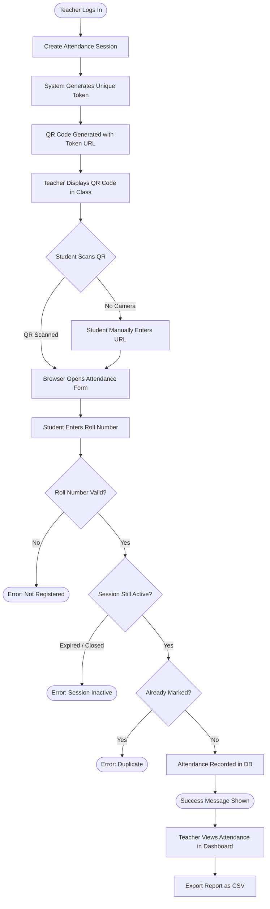

# PROJECT REPORT

## AttendEase: QR-Based Student Attendance and Management System Using Python

**Submitted by:** Team of Two  
**Subject:** Mini Project — Python Programming  
**Date:** October 2026  
**Institution:** [Your College Name]

---

## Table of Contents

1. Introduction
2. Problem Statement
3. Objectives
4. Scope
5. Existing System
6. Proposed System
7. Software and Hardware Requirements
8. System Architecture
9. Module Descriptions
10. Database Design
11. Implementation Details
12. Testing and Results
13. Limitations
14. Future Scope
15. Conclusion

---

## 1. Introduction

Tracking student attendance is one of the most fundamental administrative tasks in any educational institution. Traditional paper-based registers and manual spreadsheets are time-consuming, error-prone, and difficult to analyse at scale. With the widespread adoption of smartphones, QR code technology provides an opportunity to make attendance collection faster, more accurate, and more transparent.

**AttendEase** is a Python-based web application that enables teachers to create digital attendance sessions, generate unique QR codes for each session, and allow students to self-register their attendance by scanning a QR code and submitting their roll number. All data is persisted in a local SQLite database, and rich analytics are available through an interactive dashboard.

The application is designed as a college mini project that demonstrates real-world software development practices: modular architecture, secure authentication, database normalisation, automated testing, and modern UI/UX design.

---

## 2. Problem Statement

Educational institutions face several challenges with conventional attendance systems:

- **Paper registers** are prone to proxy attendance (students signing for absent peers).
- **Manual data entry** into spreadsheets is slow and introduces transcription errors.
- **Generating attendance reports** is tedious and often delayed.
- **Identifying low-attendance students** requires manual counting.
- There is no real-time visibility into who is present in a class.

These inefficiencies reduce accountability, consume teacher time, and make it difficult for administrators to take early corrective action for students at risk of failing attendance criteria.

---

## 3. Objectives

1. Build a digital attendance system that eliminates paper registers.
2. Use QR codes to allow students to mark their own attendance efficiently.
3. Enforce attendance rules: reject duplicates, expired sessions, and invalid roll numbers.
4. Provide teachers with a real-time dashboard showing attendance trends.
5. Generate detailed per-student and per-session reports exportable to CSV.
6. Implement secure administrator authentication with hashed passwords.
7. Store all data persistently in a local SQLite database.
8. Make the application usable without an internet connection after installation.

---

## 4. Scope

**In scope:**
- Teacher/admin login and logout
- Student CRUD (Create, Read, Update, Delete)
- Attendance session creation with QR code generation
- Student-facing attendance submission form (via QR URL)
- Manual attendance fallback (entering the URL directly)
- Dashboard with charts and summary metrics
- Per-student and per-session attendance reports
- CSV export of attendance data
- Automated unit tests

**Out of scope:**
- Biometric or facial-recognition attendance verification
- SMS or email notifications
- Multi-school / multi-tenant deployment
- Mobile native app
- Cloud hosting
- Student self-registration portal

---

## 5. Existing System

### Paper-based Attendance Register
- Teacher calls roll or passes a paper register.
- Prone to proxy attendance.
- No real-time analysis.
- Physical storage risk (damage, loss).

### Manual Spreadsheet System
- Slightly better than paper but still manually maintained.
- No automated alerts for low attendance.
- No QR-based collection.
- Data siloed on the teacher's machine.

### Basic Attendance Software
- Many existing systems are expensive or cloud-only.
- Require internet connectivity.
- Not customisable for small college demonstrations.

---

## 6. Proposed System

AttendEase proposes a lightweight, offline-capable web application that:

1. **Authenticates teachers** using a secure username/password login. Passwords are hashed with PBKDF2-SHA256 via the Werkzeug library — never stored in plain text.
2. **Manages students** with full CRUD operations, enforcing unique roll numbers.
3. **Creates attendance sessions** for specific subjects and departments with configurable start and expiry times.
4. **Generates a unique QR code** for each session. The QR code contains a URL with a random session token.
5. **Accepts student submissions** via a public web form. Students scan the QR code, enter their roll number, and the system validates the submission before recording it.
6. **Displays live analytics** on a dashboard: total students, sessions, present today, average attendance, and low-attendance alerts.
7. **Exports reports** to CSV using Pandas for further analysis.

---

## 7. Software and Hardware Requirements

### Software Requirements
| Component | Requirement |
|---|---|
| Operating System | macOS 12+, Windows 10+, Ubuntu 20.04+ |
| Python | 3.9 or higher |
| Streamlit | ≥ 1.32.0 |
| SQLite | Bundled with Python |
| Pandas | Latest stable |
| Plotly | Latest stable |
| qrcode | Latest stable |
| Pillow | Latest stable |
| Werkzeug | Latest stable |
| pytest | Latest stable |

### Hardware Requirements
| Component | Minimum |
|---|---|
| CPU | Dual-core 1.5 GHz |
| RAM | 4 GB |
| Storage | 500 MB free |
| Display | 1280 × 720 resolution |
| Network | Local Wi-Fi for cross-device QR scanning |
| Student Device | Any smartphone with a QR scanner app and browser |

---

## 8. System Architecture

```
┌────────────────────────────────────────────────────────┐
│                    AttendEase                          │
│                                                        │
│   ┌──────────┐   ┌────────────┐   ┌────────────────┐  │
│   │  app.py  │◄──│ Streamlit  │◄──│   Browser      │  │
│   │ (Router) │   │ Framework  │   │ (Admin/Student)│  │
│   └────┬─────┘   └────────────┘   └────────────────┘  │
│        │                                               │
│   ┌────▼──────────────────────────────────────────┐    │
│   │              Business Logic Layer             │    │
│   │  auth.py  │  student_mgmt.py  │  sessions.py  │    │
│   │  attendance.py  │  reports.py               │    │
│   └────┬──────────────────────────────────────────┘    │
│        │                                               │
│   ┌────▼──────────────────────────────────────────┐    │
│   │           Data Access Layer (database.py)     │    │
│   └────┬──────────────────────────────────────────┘    │
│        │                                               │
│   ┌────▼──────────────────────────────────────────┐    │
│   │         SQLite Database (data/attendease.db)  │    │
│   └───────────────────────────────────────────────┘    │
│                                                        │
│   ┌───────────────────────────────────────────────┐    │
│   │  ui_components.py  │  config.py               │    │
│   └───────────────────────────────────────────────┘    │
└────────────────────────────────────────────────────────┘
```

### Attendance Workflow (Mermaid Flowchart)



---

## 9. Module Descriptions

### `config.py`
Centralises all application constants: file paths, QR host/port, timezone, attendance threshold, and the sample-data sentinel. Changing a setting here affects the entire application.

### `database.py`
Handles SQLite connection lifecycle with a context manager that auto-commits and rolls back on error. Provides the schema DDL (five tables), helper functions (`fetchall`, `fetchone`, `execute`), and app metadata key-value storage.

### `auth.py`
Implements PBKDF2-SHA256 password hashing via Werkzeug. Provides administrator CRUD, login/logout via Streamlit session state, and a `require_auth()` guard used by all protected pages. Creates the default `admin/admin123` account on first run if no admins exist.

### `student_management.py`
Full CRUD for the `students` table. Validates required fields, enforces unique roll numbers, and auto-generates unique Student IDs in the format `STU-XXXXXX`. Supports search by name/roll and filter by department.

### `session_management.py`
Creates attendance sessions with cryptographically random tokens (32 characters, URL-safe). Generates QR code PNG images using the `qrcode` library. The `is_session_active()` function checks both the session status (`Active`/`Closed`) and the current local time against the configured start/expiry window.

### `attendance.py`
Validates and records student attendance submissions. Enforces five rules: session exists, session is active, roll number is registered, optional department match, no duplicate submission. Returns descriptive error messages via `AttendanceError`. Provides query functions for the dashboard and reports.

### `reports.py`
Aggregates data using SQLite queries and Pandas. Provides dashboard metrics, attendance trend data (last N days), subject-wise totals, present-vs-absent overview, low-attendance student lists, and CSV export functions. Handles division-by-zero by returning 0.0 when no sessions exist.

### `ui_components.py`
Injects custom CSS (dark theme, Inter font, gradient cards, animated buttons). Provides reusable `page_header()`, `metric_card()`, `section_header()`, `empty_state()`, and `render_sidebar()` functions to keep the page code clean.

### `app.py`
Streamlit entry point. Initialises the database and default admin on startup. Routes between the public attendance-submission page (no auth required) and protected admin pages. Implements all six admin pages: Dashboard, Students, Sessions, Attendance, Reports, Settings.

### `init_sample_data.py`
Standalone script that inserts 15 fictional students, 9 historical sessions with attendance records, and one live demo session. Uses a sentinel in `app_meta` to ensure it never duplicates data on a second run.

---

## 10. Database Design

### `administrators`
| Column | Type | Constraint |
|---|---|---|
| id | INTEGER | PRIMARY KEY AUTOINCREMENT |
| username | TEXT | NOT NULL, UNIQUE |
| password_hash | TEXT | NOT NULL |
| full_name | TEXT | |
| created_at | TEXT | DEFAULT current UTC timestamp |

### `students`
| Column | Type | Constraint |
|---|---|---|
| id | INTEGER | PRIMARY KEY AUTOINCREMENT |
| student_id | TEXT | NOT NULL, UNIQUE |
| roll_number | TEXT | NOT NULL, UNIQUE |
| full_name | TEXT | NOT NULL |
| department | TEXT | NOT NULL |
| email | TEXT | |
| registered_at | TEXT | DEFAULT current UTC timestamp |

### `attendance_sessions`
| Column | Type | Constraint |
|---|---|---|
| id | INTEGER | PRIMARY KEY AUTOINCREMENT |
| session_token | TEXT | NOT NULL, UNIQUE |
| department | TEXT | NOT NULL |
| subject | TEXT | NOT NULL |
| session_date | TEXT | NOT NULL (YYYY-MM-DD) |
| start_time | TEXT | NOT NULL (HH:MM) |
| expiry_time | TEXT | NOT NULL (HH:MM) |
| status | TEXT | CHECK IN ('Active','Closed') |
| created_by | TEXT | NOT NULL |
| created_at | TEXT | DEFAULT current UTC timestamp |

### `attendance_records`
| Column | Type | Constraint |
|---|---|---|
| id | INTEGER | PRIMARY KEY AUTOINCREMENT |
| session_id | INTEGER | FOREIGN KEY → attendance_sessions(id) ON DELETE RESTRICT |
| student_id | INTEGER | FOREIGN KEY → students(id) ON DELETE RESTRICT |
| recorded_at | TEXT | DEFAULT current UTC timestamp |
| | | UNIQUE(session_id, student_id) |

### `app_meta`
| Column | Type | Constraint |
|---|---|---|
| key | TEXT | PRIMARY KEY |
| value | TEXT | |

---

## 11. Implementation Details

### Security
- Passwords stored as PBKDF2-SHA256 hashes with a random 16-byte salt.
- All SQL queries use parameterised statements — no string concatenation.
- Foreign-key enforcement enabled via `PRAGMA foreign_keys = ON`.
- Session tokens are 32-character cryptographically random strings.

### Concurrency
- SQLite WAL (Write-Ahead Logging) mode enabled for better concurrent read performance.
- Each request uses a fresh connection (context manager pattern) to avoid shared-state issues with Streamlit's rerun model.

### Timezone
- All timestamps stored as UTC ISO-8601 strings.
- Session start/expiry comparison uses `zoneinfo` (Python 3.9+) with the `Asia/Kolkata` timezone by default. Configurable in `config.py`.

### QR Code
- Generated using the `qrcode` library with error correction level M.
- Saved as PNG in the `assets/` directory.
- URL format: `http://<QR_HOST>:<QR_PORT>/?page=mark_attendance&token=<TOKEN>`

---

## 12. Testing and Results

Automated tests are located in the `tests/` directory and run with pytest.

### Test Coverage

| Module | Tests | Coverage |
|---|---|---|
| database.py | 6 | Schema, CRUD helpers, meta |
| auth.py | 11 | Hash/verify, CRUD, session state |
| student_management.py | 13 | Add, get, search, update, delete |
| session_management.py | 11 | Create, read, status, close/reopen |
| attendance.py | 9 | Valid mark, invalid roll, bad token, duplicate, closed, expired |
| reports.py | 10 | Metrics, pct calc, CSV export |
| **Total** | **60** | |

### How to Run Tests
```bash
# From the AttendEase directory
pytest tests/ -v
```

> **Note:** Tests use a temporary SQLite database isolated from the production database. No production data is affected.

---

## 13. Limitations

1. **No physical presence verification** — A student can share the QR code URL and a classmate can submit attendance remotely. This is a known prototype limitation.
2. **Local only** — The application runs on localhost. Cross-device QR scanning requires all devices to be on the same Wi-Fi network.
3. **Single administrator role** — All admins have equal privileges; there is no teacher vs. super-admin distinction.
4. **No student self-registration** — Students must be added by an administrator.
5. **No password reset email** — Password changes must be done by an admin through the Settings page.
6. **SQLite** — Not suitable for high-concurrency or distributed deployments; intended for single-machine use.

---

## 14. Future Scope

1. **OTP or college ID verification** on the attendance form to reduce proxy attendance.
2. **Facial recognition** using OpenCV for biometric verification.
3. **Student portal** — Allow students to log in and view their own attendance history.
4. **Email/SMS alerts** for students below the attendance threshold.
5. **Multi-teacher roles** — Teachers can only manage their own sessions and subjects.
6. **Cloud deployment** — Deploy to a cloud server so students can access it from anywhere.
7. **Mobile app** — React Native or Flutter app for QR scanning and attendance viewing.
8. **Integration with college ERP** — Sync with existing student information systems.
9. **Timetable management** — Auto-create sessions based on a pre-loaded class schedule.

---

## 15. Conclusion

AttendEase successfully demonstrates how a modern Python web application can streamline a common administrative task. The system covers the complete attendance lifecycle — from session creation and QR code generation, through student submission and validation, to analytics and CSV export. The codebase is modular, tested, and documented to a standard appropriate for a college demonstration and viva examination.

The project gave both team members practical experience with Python web frameworks (Streamlit), relational databases (SQLite), data analysis (Pandas), data visualisation (Plotly), QR code generation, secure password hashing, and automated testing (pytest). It demonstrates real-world software engineering practices within a scope achievable by a two-person team in one week.

---

*End of Project Report*
