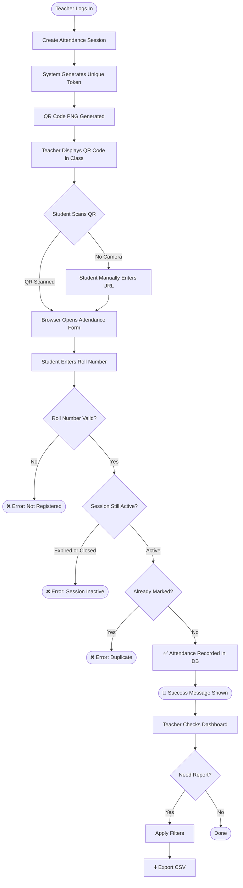

# 📋 AttendEase

### Smart Attendance Management System

> A complete QR-based student attendance tracking system built with Python, Streamlit, and SQLite. Designed as a college mini project that demonstrates real-world software engineering practices.

[](https://python.org)
[](https://streamlit.io)
[](https://sqlite.org)
[](LICENSE)

---

## 📖 Abstract

AttendEase replaces paper attendance registers with a modern QR-code-driven web application. Teachers create digital sessions, display a QR code, and students scan it to self-register their attendance. All data is stored in a local SQLite database. Rich analytics, low-attendance alerts, and CSV exports give teachers instant visibility into class attendance patterns — all without an internet connection after installation.

---

## 🚩 Problem Statement

Traditional paper-based and spreadsheet attendance systems in colleges suffer from:

- **Proxy attendance** — students sign for absent friends
- **Manual data entry errors** — transcription mistakes in spreadsheets
- **No real-time analysis** — reports take days to compile
- **No automated alerts** — low-attendance students identified too late
- **Storage risk** — paper registers can be lost or damaged

---

## 🎯 Objectives

1. Eliminate paper registers with a digital attendance system
2. Use QR codes for fast student self-registration
3. Enforce business rules (no duplicates, no expired sessions, valid roll numbers)
4. Provide a real-time dashboard with charts and metrics
5. Generate exportable CSV reports for administrative use
6. Implement secure hashed-password authentication
7. Persist all data locally — works offline after installation

---

## ⚠️ Existing System Limitations

| Limitation | Paper Register | Spreadsheet | AttendEase |
|---|---|---|---|
| Proxy attendance risk | ❌ High | ❌ High | ⚠️ Reduced (prototype) |
| Real-time analytics | ❌ None | ❌ None | ✅ Live dashboard |
| Low-attendance alerts | ❌ Manual | ❌ Manual | ✅ Automated |
| Data persistence | ❌ Paper | ⚠️ One machine | ✅ SQLite DB |
| Export to CSV | ❌ No | ⚠️ Manual | ✅ One-click |
| Duplicate prevention | ❌ No | ❌ No | ✅ DB constraint |

---

## ✨ Features

### 🔐 Authentication
- Secure login for teachers/admins
- PBKDF2-SHA256 password hashing (never stored in plain text)
- Session-based authentication via Streamlit session state
- Change password from Settings page

### 👥 Student Management
- Add, edit, delete student records
- Auto-generated unique Student IDs (`STU-XXXXXX`)
- Search by name or roll number
- Filter by department
- Duplicate roll-number prevention

### 📅 Session Management
- Create attendance sessions with subject, date, start/expiry time
- Automatic QR code generation for each session
- Close or reopen sessions
- View all attendance records per session

### ✅ QR-Based Attendance
- Unique session token embedded in QR URL
- Student scans QR → enters roll number → attendance recorded
- Validates: session active, roll exists, no duplicate, time window
- Manual URL entry fallback for devices without QR scanner

### 📊 Dashboard & Analytics
- Summary cards: total students, sessions, today's count, avg %, low-attendance count
- 30-day attendance trend line chart
- Present vs Absent donut chart
- Subject-wise attendance bar chart
- Low-attendance student table

### 📈 Reports
- Per-student attendance percentage
- Per-session present/absent counts
- Low-attendance threshold alert (configurable, default 75%)
- Attendance distribution histogram

### ⬇️ CSV Export
- Export filtered attendance records
- Export student attendance summaries with below-threshold flag

---

## 🛠️ Technology Stack

| Component | Technology | Purpose |
|---|---|---|
| Language | Python 3.9+ | Core application logic |
| Web Framework | Streamlit ≥ 1.32 | UI and web server |
| Database | SQLite (built-in) | Persistent data storage |
| Data Processing | Pandas | DataFrames, CSV export |
| Visualisation | Plotly | Interactive charts |
| QR Generation | qrcode + Pillow | QR code PNG generation |
| Authentication | Werkzeug | PBKDF2-SHA256 password hashing |
| Testing | pytest | Automated unit tests |
| Fonts | Google Fonts (Inter) | Typography (loaded at runtime) |

---

## 💻 System Requirements

| Component | Minimum |
|---|---|
| OS | macOS 12, Windows 10, Ubuntu 20.04 |
| Python | 3.9 or higher |
| RAM | 4 GB |
| Storage | 500 MB free |
| Browser | Chrome, Firefox, Safari, Edge |
| Phone (for QR) | Any smartphone with a QR scanner + browser |
| Network (QR scanning) | Same Wi-Fi for teacher's computer and student's phone |

---

## 🗄️ Database Schema

### `administrators`
```sql
CREATE TABLE administrators (
    id            INTEGER PRIMARY KEY AUTOINCREMENT,
    username      TEXT    NOT NULL UNIQUE COLLATE NOCASE,
    password_hash TEXT    NOT NULL,
    full_name     TEXT,
    created_at    TEXT    NOT NULL DEFAULT (strftime('%Y-%m-%dT%H:%M:%SZ','now'))
);
```

### `students`
```sql
CREATE TABLE students (
    id            INTEGER PRIMARY KEY AUTOINCREMENT,
    student_id    TEXT    NOT NULL UNIQUE,
    roll_number   TEXT    NOT NULL UNIQUE COLLATE NOCASE,
    full_name     TEXT    NOT NULL,
    department    TEXT    NOT NULL,
    email         TEXT,
    registered_at TEXT    NOT NULL DEFAULT (strftime('%Y-%m-%dT%H:%M:%SZ','now'))
);
```

### `attendance_sessions`
```sql
CREATE TABLE attendance_sessions (
    id            INTEGER PRIMARY KEY AUTOINCREMENT,
    session_token TEXT    NOT NULL UNIQUE,
    department    TEXT    NOT NULL,
    subject       TEXT    NOT NULL,
    session_date  TEXT    NOT NULL,   -- YYYY-MM-DD
    start_time    TEXT    NOT NULL,   -- HH:MM
    expiry_time   TEXT    NOT NULL,   -- HH:MM
    status        TEXT    NOT NULL DEFAULT 'Active'
                          CHECK(status IN ('Active','Closed')),
    created_by    TEXT    NOT NULL,
    created_at    TEXT    NOT NULL DEFAULT (strftime('%Y-%m-%dT%H:%M:%SZ','now'))
);
```

### `attendance_records`
```sql
CREATE TABLE attendance_records (
    id          INTEGER PRIMARY KEY AUTOINCREMENT,
    session_id  INTEGER NOT NULL REFERENCES attendance_sessions(id) ON DELETE RESTRICT,
    student_id  INTEGER NOT NULL REFERENCES students(id)            ON DELETE RESTRICT,
    recorded_at TEXT    NOT NULL DEFAULT (strftime('%Y-%m-%dT%H:%M:%SZ','now')),
    UNIQUE (session_id, student_id)   -- prevents duplicate attendance
);
```

### `app_meta`
```sql
CREATE TABLE app_meta (
    key   TEXT PRIMARY KEY,
    value TEXT
);
```

---

## 🚀 Installation

### Step 1 — Clone or download the project
```bash
# If using git:
git clone <your-repo-url> AttendEase
cd AttendEase

# Or simply navigate to the project folder:
cd /path/to/AttendEase
```

### Step 2 — Create a virtual environment (recommended)
```bash
python3 -m venv venv

# Activate on macOS/Linux:
source venv/bin/activate

# Activate on Windows:
venv\Scripts\activate
```

### Step 3 — Install dependencies
```bash
pip install -r requirements.txt
```

### Step 4 — Run the application
```bash
streamlit run app.py
```

The app will open automatically at **http://localhost:8501**

---

## 🔐 First-Time Administrator Setup

On first launch, AttendEase automatically creates a default admin account:

| Field | Value |
|---|---|
| Username | `admin` |
| Password | `admin123` |

> ⚠️ **Change this password immediately after your first login.**

**To change the password:**
1. Log in with `admin` / `admin123`
2. Click **⚙️ Settings** in the sidebar
3. Go to the **🔑 Change Password** tab
4. Enter and confirm your new password
5. Click **Update Password**

**To add another administrator:**
1. Go to **⚙️ Settings → 👤 Admin Accounts**
2. Fill in the new admin's username, full name, and password
3. Click **Add Admin**

---

## 🎭 Sample Data Initialization

Load 15 fictional students, 9 historical sessions with attendance records, and one live demo session:

```bash
python init_sample_data.py
```

Output:
```
Loading sample data…
  Added student: CS001 — Aarav Mehta
  ...
  Added session: Computer Science / Data Structures on 2026-10-10
  ...
  Created LIVE demo session (token: AbCdEfGhIjKl…)

✅ Sample data loaded successfully.
   Run `streamlit run app.py` to start the application.
```

> **This script is safe to run only once.** It writes a sentinel value to the database and exits without inserting duplicates on subsequent runs.

---

## 📱 QR Code Scanning Instructions

### Testing on the same machine
1. Create a session in the **📅 Sessions** page
2. The QR code is displayed automatically
3. Copy the **Attendance URL** shown below the QR code
4. Open the URL in a new browser tab
5. Enter a registered roll number and submit

### Testing from a phone on the same Wi-Fi network

**Step 1 — Find your computer's LAN IP address:**
```bash
# macOS:
ipconfig getifaddr en0

# Windows:
ipconfig
# Look for "IPv4 Address" under your Wi-Fi adapter

# Linux:
hostname -I
```

**Step 2 — Update `config.py`:**
```python
QR_HOST = "192.168.1.10"   # Replace with your actual LAN IP
QR_PORT = 8501
```

**Step 3 — Start Streamlit to listen on all interfaces:**
```bash
streamlit run app.py --server.address 0.0.0.0 --server.port 8501
```

**Step 4 — Allow firewall access (if prompted):**
- macOS: Click "Allow" when macOS asks about incoming connections
- Windows: Allow Python/Streamlit through Windows Defender Firewall

**Step 5 — Scan the QR code:**
- Open the phone's camera app and point it at the QR code
- Tap the notification to open the URL in the phone's browser
- Enter your roll number and tap Submit

> ⚠️ **Security Note:** This prototype does not verify physical presence. A student could share the URL with a classmate who is not present. Additional authentication (OTP, biometric, college ID scan) would be required in a production system.

---

## 📊 Attendance Percentage Formula

```
Attendance % = (Sessions Attended / Applicable Sessions) × 100
```

**Applicable sessions** = All sessions for the student's department (regardless of when the student was registered).

**Division by zero** is handled by returning `0.0` when no sessions exist for the student's department.

---

## ⬇️ CSV Export Instructions

### Export attendance records:
1. Go to **✅ Attendance** page
2. Apply optional filters (department, subject, date range)
3. Click **⬇️ Export to CSV**

### Export student summaries:
1. Go to **📊 Reports → ⬇️ Export** tab
2. Set threshold (optional)
3. Click **⬇️ Download Student Summary CSV**

---

## 🧪 Testing Instructions

```bash
# Run all tests with verbose output:
python3 -m pytest tests/ -v

# Run a specific test file:
python3 -m pytest tests/test_attendance.py -v

# Run a specific test:
python3 -m pytest tests/test_auth.py::test_hash_and_verify -v

# Show test coverage summary:
python3 -m pytest tests/ -v --tb=short
```

Tests use an isolated temporary database — your production `data/attendease.db` is never touched.

---

## ⚠️ Known Limitations

1. **No physical presence verification** — Students could share the URL/QR code
2. **Local network only** — Requires same Wi-Fi for cross-device QR scanning
3. **SQLite** — Not for high-concurrency or distributed use; single-machine only
4. **Single admin role** — No teacher vs. admin role distinction
5. **No student self-registration** — Admins must add students manually
6. **No email/SMS alerts** — Low-attendance alerts are dashboard-only
7. **No password reset email** — Must be reset by an admin via Settings
8. **Timezone** — Configurable in `config.py`; defaults to `Asia/Kolkata`

---

## 🔮 Future Enhancements

- OTP verification on the attendance form to reduce proxy submissions
- Facial recognition via OpenCV for biometric verification
- Student self-login portal to view personal attendance
- Email/SMS notifications for students below threshold
- Teacher accounts with subject-level access control
- Cloud deployment (e.g., Streamlit Cloud, Heroku)
- Mobile app (Flutter or React Native)
- Integration with college ERP systems
- Timetable-driven auto session creation

---

## 👥 Team Contribution Breakdown

### Team Member 1 — Backend & Core Logic
| Area | Contribution |
|---|---|
| Database design | `database.py` — schema, connection helpers, transactions |
| Authentication | `auth.py` — hashing, session state, admin CRUD |
| Student management | `student_management.py` — CRUD, validation |
| Session management | `session_management.py` — tokens, QR generation, status |
| Attendance logic | `attendance.py` — validation, recording, queries |

### Team Member 2 — UI, Analytics & Documentation
| Area | Contribution |
|---|---|
| Streamlit interface | `app.py` — all pages and routing |
| Dashboard & charts | `reports.py` + Plotly charts in `app.py` |
| QR code interface | Session page, public attendance form |
| Reports & CSV export | `reports.py`, export buttons |
| Documentation | `README.md`, `PROJECT_REPORT.md` |
| UI styling | `ui_components.py` — CSS, components |

**Both members:** Integration testing, `init_sample_data.py`, `tests/`, viva preparation

---

## 🗺️ Attendance Workflow Flowchart



---

## ❓ Viva Questions and Answers

**Q1. What is the purpose of AttendEase?**  
A. AttendEase is a QR-code-based student attendance management system that allows teachers to create digital attendance sessions, generate QR codes, and let students mark their own attendance by scanning the QR code and submitting their roll number. It replaces paper registers and provides real-time analytics.

**Q2. Which database does AttendEase use and why?**  
A. SQLite — it is built into Python's standard library (no separate installation), stores data in a single file, supports SQL with ACID transactions, and is perfectly suitable for single-machine, low-concurrency applications like a college demo project.

**Q3. How are passwords stored? Why not in plain text?**  
A. Passwords are stored as PBKDF2-SHA256 hashes using the Werkzeug library. Plain-text passwords are a serious security risk — if the database is ever exposed, attackers would immediately have everyone's password. Hashing is a one-way operation; the original password cannot be recovered from the hash.

**Q4. How does the QR code work?**  
A. When a teacher creates a session, a 32-character cryptographically random token is generated and stored in the database. The QR code encodes the URL `http://<host>:<port>/?page=mark_attendance&token=<TOKEN>`. When a student scans the QR, their browser opens this URL and displays a form where they enter their roll number.

**Q5. How does the system prevent duplicate attendance?**  
A. The `attendance_records` table has a `UNIQUE(session_id, student_id)` constraint. If a student tries to submit twice for the same session, the database rejects the insert with an IntegrityError. The application catches this and shows a user-friendly error message.

**Q6. What happens if a student submits attendance after the session has expired?**  
A. The `is_session_active()` function compares the current local time (in the configured timezone) against the session's `start_time` and `expiry_time` on the session's date. If the current time is outside this window, the function returns `False` and the submission is rejected with an appropriate error message.

**Q7. What are the five rules validated before recording attendance?**  
A. (1) Session token must exist. (2) Session status must be `Active`. (3) Current time must be within the start-to-expiry window. (4) Roll number must belong to a registered student. (5) The student must not already have an attendance record for this session.

**Q8. What is PRAGMA foreign_keys and why is it needed?**  
A. SQLite does not enforce foreign-key constraints by default for backward compatibility. The `PRAGMA foreign_keys = ON` statement enables enforcement so that, for example, you cannot delete a student who has attendance records (ON DELETE RESTRICT). This prevents orphaned records and database corruption.

**Q9. What is the attendance percentage formula used?**  
A. `Attendance % = (Sessions Attended / Applicable Sessions) × 100`. "Applicable sessions" are all sessions for the student's department. When the denominator is zero (no sessions yet), the result is 0.0 to avoid division-by-zero errors.

**Q10. How does the system handle Streamlit's rerun model without recreating the database?**  
A. The `database.py` `init_db()` function uses `CREATE TABLE IF NOT EXISTS` SQL, so it is safe to call on every Streamlit rerun — it does nothing if the tables already exist. The database file lives at a fixed path (`data/attendease.db`) on disk and persists between runs.

**Q11. What is WAL journal mode and why is it used?**  
A. WAL (Write-Ahead Logging) is a SQLite journal mode that allows concurrent reads and writes without blocking. It improves performance when multiple Streamlit browser tabs query the database simultaneously.

**Q12. What does `ON DELETE RESTRICT` mean in the schema?**  
A. It means the database will refuse to delete a parent record (student or session) if child records (attendance entries) still reference it. This prevents accidentally orphaning attendance history when a student is removed. The admin must delete attendance records first, or the application can show a friendly error.

**Q13. How is the sample data loaded, and how is duplicate loading prevented?**  
A. `init_sample_data.py` is a standalone script run manually. Before inserting anything, it checks the `app_meta` table for the key `SAMPLE_DATA_LOADED_V1`. If found, it exits immediately. After successful insertion it writes this sentinel, so re-running the script is always safe.

**Q14. Why is `zoneinfo` used instead of storing timestamps in local time?**  
A. All timestamps are stored in UTC for correctness and portability — UTC never has daylight-saving ambiguity. `zoneinfo` (built into Python 3.9+) converts UTC to the local timezone (`Asia/Kolkata` by default) only for display and session-window comparisons, ensuring consistent behaviour regardless of the server's OS timezone setting.

**Q15. What are the known limitations of this prototype?**  
A. (1) No biometric or identity verification — students can share the QR URL. (2) Local-network only — cross-device access requires same Wi-Fi. (3) SQLite is not suitable for high concurrency or distributed deployments. (4) No student self-registration portal. (5) No email or SMS notifications for low attendance.

---

## 📁 Project Structure

```
AttendEase/
├── app.py                  # Main Streamlit entry point and page routing
├── config.py               # Application-wide constants and settings
├── database.py             # SQLite schema, connection management, helpers
├── auth.py                 # Password hashing, admin CRUD, session auth
├── student_management.py   # Student CRUD operations
├── session_management.py   # Session CRUD, token generation, QR code
├── attendance.py           # Attendance recording, validation, queries
├── reports.py              # Dashboard metrics, charts data, CSV export
├── ui_components.py        # Reusable Streamlit UI components and CSS
├── init_sample_data.py     # One-time demo data seeder
├── requirements.txt        # Python package dependencies
├── pytest.ini              # Pytest configuration
├── README.md               # This file
├── PROJECT_REPORT.md       # Formal project report
├── .gitignore              # Excludes DB, QRs, venv, cache
├── data/
│   └── attendease.db       # SQLite database (auto-created, not committed)
├── assets/
│   └── qr_*.png            # Generated QR codes (not committed)
└── tests/
    ├── __init__.py
    ├── conftest.py          # Shared fixtures (temp DB isolation)
    ├── test_database.py     # DB init and helper tests
    ├── test_auth.py         # Authentication tests
    ├── test_students.py     # Student CRUD tests
    ├── test_sessions.py     # Session management tests
    ├── test_attendance.py   # Attendance validation tests
    └── test_reports.py      # Reports and CSV export tests
```

---

## 📋 Quick Command Reference

```bash
# Install dependencies
pip install -r requirements.txt

# Start the application
streamlit run app.py

# Start with cross-device QR support (set QR_HOST in config.py first)
streamlit run app.py --server.address 0.0.0.0 --server.port 8501

# Load demo data (run once)
python init_sample_data.py

# Run all tests
python3 -m pytest tests/ -v

# Run tests for a specific module
python3 -m pytest tests/test_attendance.py -v
```

---

*AttendEase — Built with ❤️ using Python, Streamlit, and SQLite*
